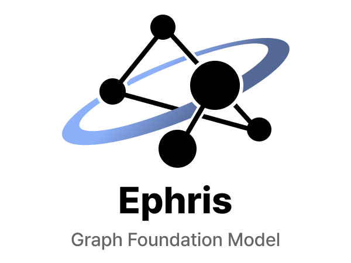
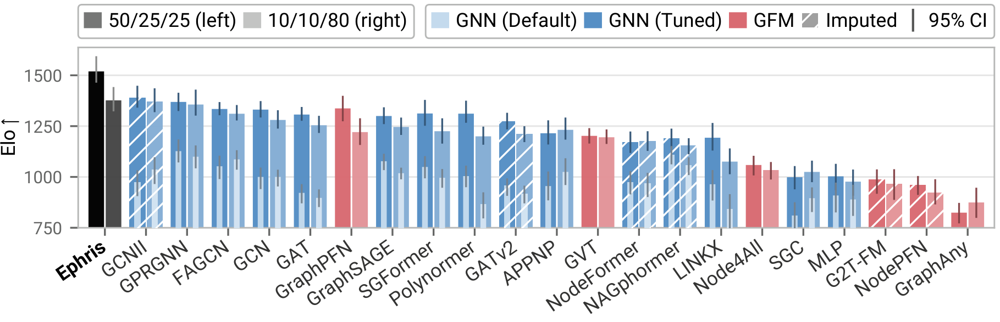
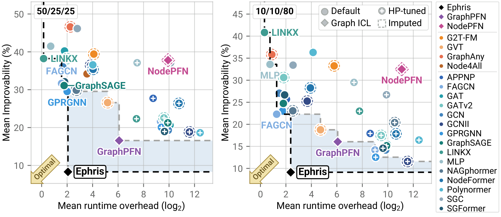
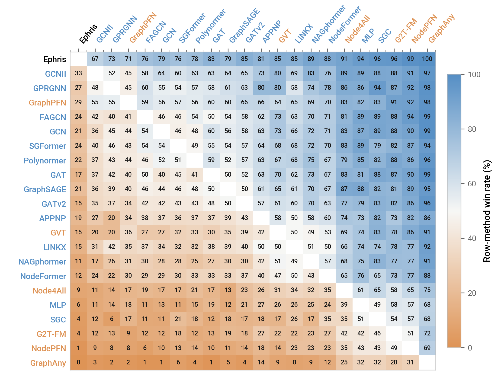

# Ephris

<div align="center">
  
</div>

Ephris is a pretrained graph foundation model from Nums AI Inc. for node
classification through graph in-context learning. It predicts query-node labels
from graph features, edges and labeled context nodes, with no task-specific training.

[Apache-2.0 code](https://github.com/nums-ai/ephris/blob/main/LICENSE) · [Ephris License v1.0 model weights](https://huggingface.co/nums-ai/ephris/blob/d50ba6133743699ba8de7291487f81ed78bbddad/LICENSE) · [License & contact](#license--contact)

[Paper](https://arxiv.org/abs/2609.37057) · [Quick start](#quick-start) · [Notebook](#notebook) · [Benchmark results](#benchmark-results) · [Citation](#citation)

## Installation

Use standard CPython **3.11–3.14 on Linux**. Ephris uses PyTorch 2.11.0 and
PyTorch Geometric 2.8.0. Install in a virtual environment:

```bash
python -m venv .venv
source .venv/bin/activate
python -m pip install ephris
```

For CPU-only inference, install PyTorch from its CPU index first:

```bash
python -m pip install torch==2.11.0 --index-url https://download.pytorch.org/whl/cpu
python -m pip install ephris
```

### Model weights

The first prediction downloads and caches `config.json` and the checkpoint at a
fixed revision from [Hugging Face](https://huggingface.co/nums-ai/ephris). No Hugging Face account
or access token is required. The checkpoint's SHA256 is verified before loading.
`device="auto"` selects CUDA when available, otherwise CPU.
See [inference details](https://github.com/nums-ai/ephris/blob/main/docs/inference.md) for checkpoint downloads and precision.

### Install from source

To use the examples or contribute to the code:

```bash
git clone https://github.com/nums-ai/ephris.git
cd ephris
python -m pip install .
```

The optional [environment.lock](https://github.com/nums-ai/ephris/blob/main/environment.lock) pins a Python 3.11 / CUDA 13.0
setup. Install it with `python -m pip install -r environment.lock` before Ephris.
This setup requires a compatible NVIDIA driver.

## Quick start

```python
import torch
from ephris import EphrisClassifier

x = torch.tensor([[0.1, 0.2], [0.8, 0.9], [0.2, 0.1], [0.9, 0.8]])
edge_index = torch.tensor([[0, 1, 2, 3], [2, 3, 0, 1]])
context_indices = torch.tensor([0, 1])
query_indices = torch.tensor([2, 3])
context_labels = torch.tensor([0, 1])

model = EphrisClassifier(random_state=42, device="auto")
labels = model.predict(
    x, edge_index,
    context_indices=context_indices, context_labels=context_labels,
)
print(labels[query_indices])
```

No `fit()` call is required. Pass the graph and the labels of the context nodes;
query labels are never prediction inputs. `predict()` returns original class
labels for **all nodes**, including context nodes, as a CPU tensor `[N]`.
Select query nodes with `labels[query_indices]`.

### Class probabilities

Use `predict_proba()` instead of `predict()` when probabilities are needed:

```python
probabilities = model.predict_proba(
    x, edge_index,
    context_indices=context_indices, context_labels=context_labels,
)
query_probabilities = probabilities[query_indices]
print(query_probabilities)

# Get labels from these probabilities without running another prediction.
query_labels = model.classes_[query_probabilities.argmax(dim=1)]
print(query_labels)
```

Inputs can be NumPy arrays or PyTorch tensors. Features have shape `[N, F]`, edges
`[2, E]`, and context indices and labels both `[K]`, paired in the same order.
Only context labels are accepted, with at least two distinct classes. Probabilities
are FP32 CPU tensors of shape `[N, C]`, where `C = len(model.classes_)`.
The sorted `classes_` tensor gives the original label for each probability column.
For class alignment in evaluators, see the [input contract](https://github.com/nums-ai/ephris/blob/main/docs/inference.md).

The native head supports ten classes; larger tasks use deterministic error-correcting
output codes (ECOC). Edges are unweighted and treated as undirected; reverse
edges and missing self-loops are added internally. See the runnable
[classification example](https://github.com/nums-ai/ephris/blob/main/examples/classification.py) and [input contract](https://github.com/nums-ai/ephris/blob/main/docs/inference.md).

## Options

Set these options when constructing `EphrisClassifier(...)`. Prediction loads weights and prepares the graph automatically.

| Parameter | Default | Behavior |
| --- | --- | --- |
| `checkpoint` | `None` | First prediction downloads the pinned Hub checkpoint; an explicit local path bypasses the Hub |
| `device` | `"auto"` | CUDA when available, otherwise CPU; explicit `"cpu"` and `"cuda:0"` are supported |
| `random_state` | `42` | Nonnegative integer seed controlling the ECOC codebook |

Use `predict_log_proba()` when a calculation needs natural-log probabilities,
such as negative log-likelihood. Ordinary label and probability predictions use
`predict()` and `predict_proba()`. CUDA uses BF16 autocast on supported
GPUs; CPU uses FP32. See [inference details](https://github.com/nums-ai/ephris/blob/main/docs/inference.md) for label visibility,
checkpoint downloads and reproducibility.

## Repeated prediction

Prepare the graph once to reuse loaded weights and prepared state. Compute one
result to obtain both probabilities and labels:

```python
model.prepare(
    x, edge_index,
    context_indices=context_indices, context_labels=context_labels,
)
log_probabilities = model.predict_prepared_log_proba()
probabilities = log_probabilities.exp()
labels = model.classes_[log_probabilities.argmax(dim=1)]
print(labels[query_indices])
print(probabilities[query_indices])
```

Further calls to `predict_prepared_log_proba()` run inference on the same prepared
graph; they reuse preparation rather than previously computed outputs. Prepare
again when inputs or context labels change. See
[prepared prediction](https://github.com/nums-ai/ephris/blob/main/examples/prepared_prediction.py).

## Notebook

From the source checkout, install the notebook dependencies:

```bash
python -m pip install '.[notebook]'
python -m jupyterlab examples/inference_demo.ipynb
```

The demo compares Ephris with GCN and GAT trained on the same context labels.
It runs Cornell, Reed98, Cora and the full 114,127-node CityNetwork Paris graph.
Binary tasks use ROC-AUC; multiclass tasks use accuracy. The notebook contains
an executed result table and performance chart, with one run per method and graph.
GCN/GAT use two layers and 200 training epochs on a seeded 50% context / 50% query
split. A CUDA GPU is recommended for the full comparison.

[View the saved demo results](https://github.com/nums-ai/ephris/blob/main/docs/benchmarks/README.md). GCN/GAT training stays
in the notebook; the installed Ephris package is inference-only. Use the same
virtual environment's kernel.

## Benchmark results

### Elo leaderboard

[](https://github.com/nums-ai/ephris/blob/main/docs/benchmarks/paper/leaderboards.md)

[View all leaderboard figures →](https://github.com/nums-ai/ephris/blob/main/docs/benchmarks/paper/leaderboards.md)

### Runtime and improvability

[](https://github.com/nums-ai/ephris/blob/main/docs/benchmarks/paper/runtime.md)

[View all runtime–performance figures →](https://github.com/nums-ai/ephris/blob/main/docs/benchmarks/paper/runtime.md)

### Pairwise win rates · 50/25/25

[](https://github.com/nums-ai/ephris/blob/main/docs/benchmarks/paper/win-rates.md)

[View both win-rate matrices →](https://github.com/nums-ai/ephris/blob/main/docs/benchmarks/paper/win-rates.md)

## License & contact

Code is licensed under [Apache-2.0](https://github.com/nums-ai/ephris/blob/main/LICENSE); model weights are separately licensed
under [Ephris License v1.0](https://huggingface.co/nums-ai/ephris/blob/d50ba6133743699ba8de7291487f81ed78bbddad/LICENSE).
Non-commercial research and free research redistribution are permitted under its
conditions. Commercial or production use, and hosted/API/SaaS services whether
paid or free, require separate licenses. Contact contact@nums.world.

Third-party dependencies and datasets keep their own terms.

## Citation

If you use Ephris in research, please cite:

```bibtex
@misc{lee2026messagepassingdoesincontext,
  title={Message Passing Does More with Less for In-Context Learning on Graphs},
  author={Dooho Lee and Jinmo Lee and Minho Jeong and Kijung Shin and Jaemin Yoo},
  year={2026},
  eprint={2609.37057},
  archivePrefix={arXiv},
  primaryClass={cs.LG},
  url={https://arxiv.org/abs/2609.37057},
}
```
