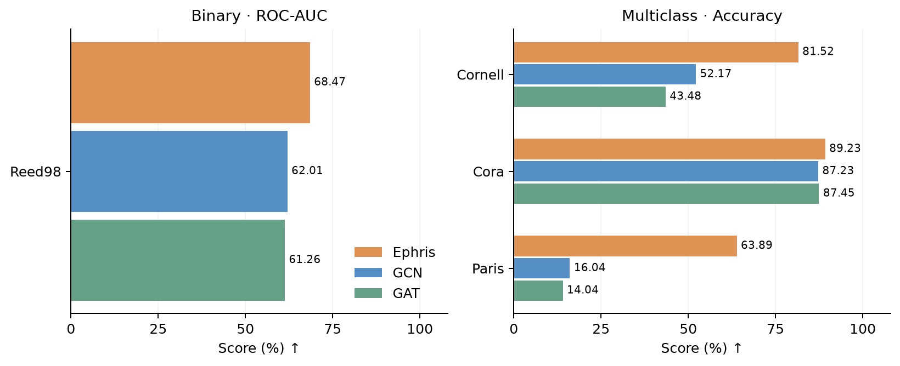

# Inference demo results

[Open the executed notebook](../../examples/inference_demo.ipynb) ·
[Main README](../../README.md#notebook)

Ephris is compared with GCN and GAT trained on the same visible context labels.
Binary classification uses ROC-AUC; multiclass classification uses accuracy.
Scores from the executed notebook are shown as percentages.

| Dataset | Nodes | Metric | Ephris | GCN | GAT |
| --- | ---: | --- | ---: | ---: | ---: |
| Cornell | 183 | Accuracy | **81.52** | 52.17 | 43.48 |
| Reed98 | 962 | ROC-AUC | **68.47** | 62.01 | 61.26 |
| Cora | 2,708 | Accuracy | **89.23** | 87.23 | 87.45 |
| Paris | 114,127 | Accuracy | **63.89** | 16.04 | 14.04 |

[Download the vector PDF](inference-performance.pdf).

## Setup

- One stratified 50% context / 50% query split, seed 42, using the full graphs.
- All methods receive the same features, undirected edges and context labels.
- GCN and GAT have two layers, 64 hidden channels and dropout 0.5; GAT uses four
  first-layer heads. Both train once for 200 Adam epochs, with learning rate 0.01
  and weight decay 0.0005. GNN features are row-normalized.
- Ephris uses its pretrained checkpoint and preprocessing, with one prediction
  per graph. Query labels are used only for scoring.
- [CityNetwork Paris](https://github.com/LeonResearch/City-Networks) contains
  114,127 road-junction nodes, 37 augmented features and ten accessibility classes.

This is an illustrative comparison on one split with simple GNN baselines.
See the [benchmark figures](paper/README.md) for the separate benchmark evaluation.
