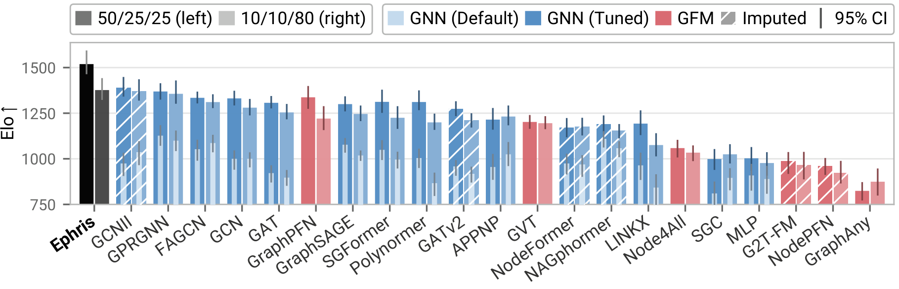
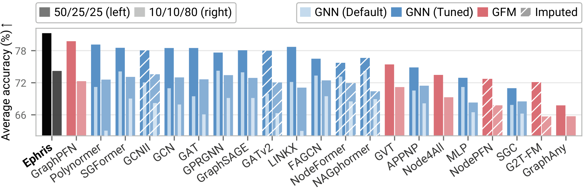
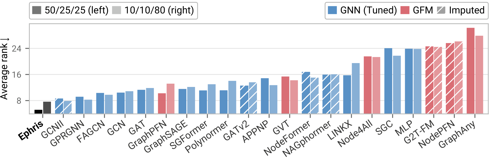
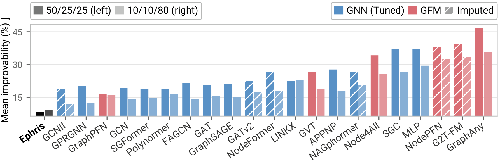
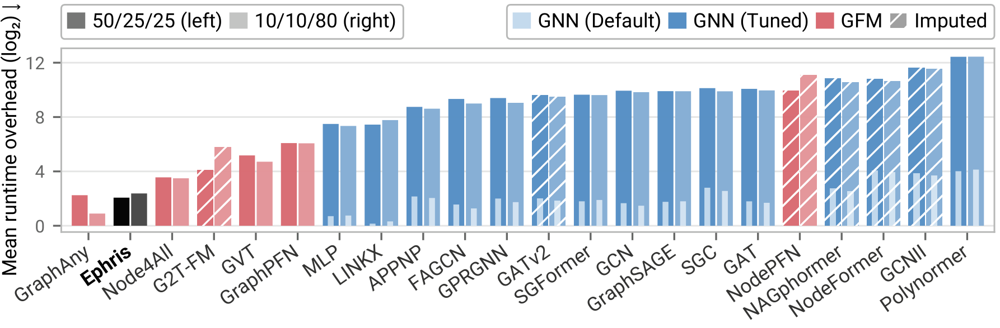

# Leaderboards

[← Benchmark overview](../../../README.md#benchmark-results)

## Elo ↑

## Average accuracy ↑

## Average rank ↓

## Mean improvability ↓

## Mean runtime overhead ↓

[← Benchmark overview](../../../README.md#benchmark-results)
